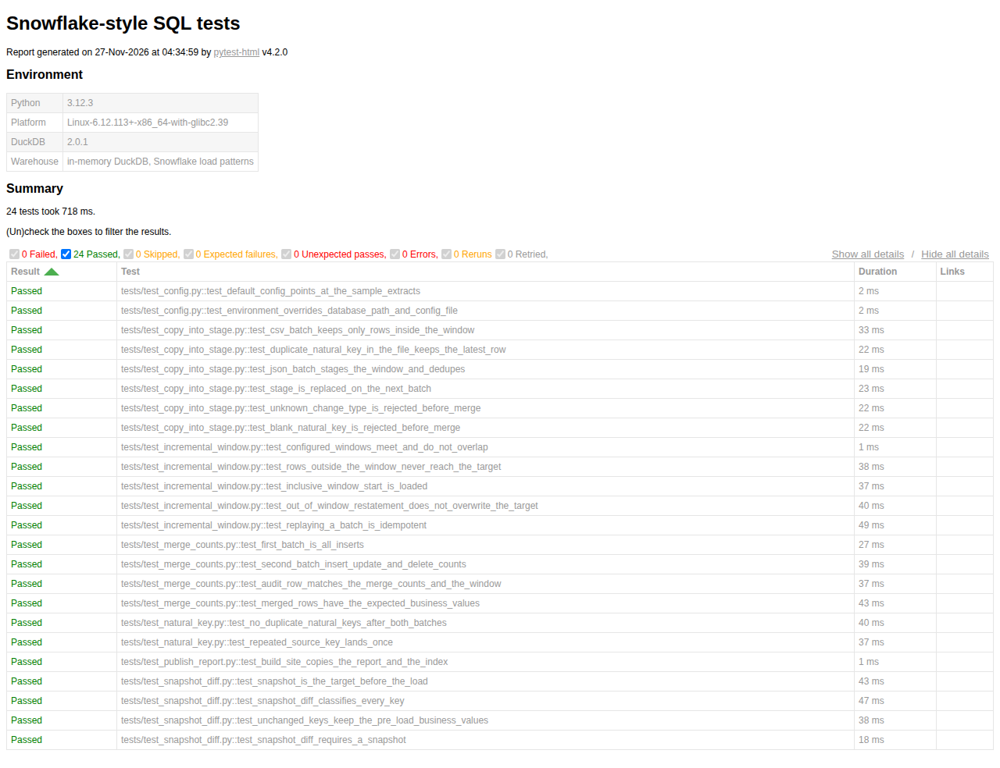

# Snowflake-style SQL tests

[](https://github.com/Potucky/n8n--test/actions/workflows/ci.yml)
[Live test report](https://potucky.github.io/snowflake-style-sql-tests/)

Warehouse load checks for a fictional subscription feed. A batch file is staged, merged into the target, and compared with a snapshot taken before the load.

This is a portfolio project. The data is fictional, and the code is not from an employer. DuckDB is the local warehouse and stands in for Snowflake, so the checks run on a laptop and in GitHub Actions. The repository has no Snowflake account and no credentials.

## What this project demonstrates

- **Stage-load validation.** A COPY-style load from CSV and JSON into a staging table, with explicit casts, a row count, and rows outside the extract window left behind. This is the file-ingestion check on a warehouse stage.
- **MERGE result checks.** Insert, update, delete, unchanged, and already-absent counts, reconciled to the change in target row count and to a `load_audit` row. This is the upsert check, past "the job finished".
- **Natural-key grain.** After MERGE, `subscription_id` has one row per key, including when the extract repeats a key. This is the duplicate check on the modeled table.
- **Incremental windows and replay.** The window is half-open, `[extract_from, extract_to)`. A row exactly at the start loads, a row exactly at the end does not, and running the same batch again does not change the target. This is watermark and reload testing.
- **Snapshot diff.** A full copy of the target is taken before the load, then keys are classified as inserted, updated, deleted, or unchanged. DuckDB has no time travel, so this table is the stand-in for Snowflake `CLONE` and for `AT (TIMESTAMP => ...)`.

## Tech stack

- Python 3.12
- DuckDB 2.0.1
- pytest and pytest-html
- PyYAML for batch windows
- GitHub Actions for the test run, the report artifact, and GitHub Pages

The warehouse logic is SQL in `sql/`. Python loads that SQL, binds the file path and the window, and the tests query the tables.

## How a batch runs

```
extract file (CSV or JSON)
    -> copy into stg_subscriptions
         half-open window, dedupe on subscription_id
    -> validate
         natural key present, change_type is UPSERT or DELETE
    -> snapshot subscriptions          optional, before MERGE
    -> classify insert / update / delete / unchanged / already_absent
    -> MERGE into subscriptions
    -> append one load_audit row
```

`change_type` is the operation on the extract. `UPSERT` inserts or updates. `DELETE` removes a matched key. A delete for a key that is already gone does not insert it, and a replay counts that row as already absent.

Timestamps in the files are naive UTC wall times, the shape of a Snowflake `TIMESTAMP_NTZ` column.

## Sample batches

| Batch | File | Window | Staged | Insert | Update | Delete |
| --- | --- | --- | --- | --- | --- | --- |
| 2026-01-15 | CSV | `[2026-01-15, 2026-01-16)` | 5 | 5 | 0 | 0 |
| 2026-01-16 | JSON | `[2026-01-16, 2026-01-17)` | 5 | 3 | 1 | 1 |

The first file has 8 rows. `sub_1003` is repeated and the later amount, 59.00, wins. `sub_1090` is before the window. `sub_1091` is exactly at the exclusive end.

The second file has 8 rows. `sub_1002` changes plan (update), `sub_1005` is a delete, and `sub_1006`, `sub_1007`, and `sub_1008` are inserts. `sub_1006` is repeated and 29.00 wins. `sub_1008` sits on the inclusive start. `sub_1001` is restated with an older timestamp and stays on the pro plan. `sub_1099` is exactly at the exclusive end.

After the second load the target has 7 rows: 5 + 3 inserts − 1 delete. Running that batch again does not change a cell.

## Project structure

```
config/warehouse.yaml          batch windows and the DuckDB path
data/raw/                      fictional CSV and JSON extracts
sql/                           DDL, COPY-style stage, MERGE, snapshot diff
src/warehouse_loads/          config, loader, Pages site assembly
tests/                         pytest checks against the warehouse tables
reporting/index.html           page that links to the HTML report
docs/test-report.png           screenshot of a local pytest-html run
.github/workflows/ci.yml       tests on push to main and on pull requests
.github/workflows/pages.yml    tests, then publish the report from main
```

## Run locally

```bash
python -m venv .venv
source .venv/bin/activate
python -m pip install -r requirements.txt
python -m pytest
python -m pytest --html=reports/report.html --self-contained-html --junitxml=reports/junit.xml
```

On Windows, activate the virtual environment with `.venv\Scripts\activate`.

Configuration:

- `config/warehouse.yaml` is the default file. Paths in it are relative to the repository root.
- `WAREHOUSE_CONFIG` points at a different YAML file.
- `WAREHOUSE_DB_PATH` overrides `database_path`. The default is `:memory:`. A file path is for a local scratch database only. The tests always open their own in-memory database.

## Test report



## Test approach

- Every test gets a new in-memory database. Tests do not share a file, and the suite does not sleep.
- The assertions read `stg_subscriptions`, `subscriptions`, `subscriptions_snapshot`, and `load_audit`. A passing return value from the loader is not the check.
- Merge counts are classified from the staged rows and the current target before MERGE runs. A second query checks that the change in row count equals inserts minus deletes, and that `load_audit` stored the same counts and the same window.
- The idempotent replay compares the whole target before and after the second run.
- A blank `subscription_id` or a `change_type` other than `UPSERT` or `DELETE` aborts the batch before MERGE and before any audit row is written.
- The Pages index is built by `warehouse_loads.publish`, which copies `reporting/index.html` and the HTML report into the site directory.

## CI and GitHub Pages

`.github/workflows/ci.yml` runs the suite on pull requests and on pushes to `main`. It uploads `reports/report.html` and `reports/junit.xml` as the `test-report` artifact.

`.github/workflows/pages.yml` runs on pushes to `main`. One job runs the tests and uploads the site with `actions/upload-pages-artifact`. The next job deploys it with `actions/deploy-pages`. The [live test report](https://potucky.github.io/snowflake-style-sql-tests/) is that site. In the repository settings, Pages has to use **Source: GitHub Actions** before the site is served.

## Author

Vasyl Popovich, QA Automation Engineer, Miami, FL. GitHub: https://github.com/Potucky
